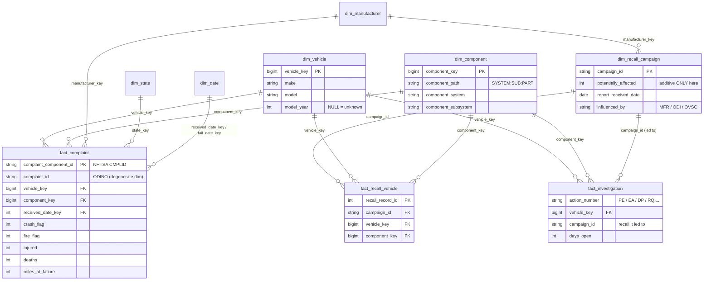

# Data model

Three layers (medallion). Bronze keeps every line exactly as received; silver is typed, cleaned current state with
change history; gold is a star schema plus data-product marts, built from SQL in `sql/gold/`.

## Star schema (gold)

## Grain decisions (the part interviewers ask about)

| Table | One row is | Why |
|---|---|---|
| `fact_complaint` | a complaint **x component** (CMPLID) | NHTSA files one row per component named. A complaint can name up to 65. Counting complaints = `COUNT(DISTINCT complaint_id)`, defined once in `metrics.yml`. |
| `dim_recall_campaign` | a recall campaign | "Potentially affected units" is a campaign-level number repeated on every raw row. Summing the raw rows would over-count (a campaign covering 40 vehicle rows counts its units 40 times). |
| `fact_recall_vehicle` | campaign x vehicle x component | What each recall covers. No unit counts here on purpose. |
| `fact_investigation` | investigation x vehicle x component x resulting campaign x manufacturer | Found by profiling (build-log F4): one investigation (e.g. Takata air bags, EA15001) led to 194 campaigns. |
| `mart_component_risk_monthly` | make x component system x month, **including zero months** | A baseline computed only over months with complaints would be biased upward and hide spikes. |
| `mart_recall_early_warning` | a vehicle recall campaign (2000+) | The data product's question is asked per recall. |

## Keys

- **Surrogate keys are hashes of the natural key** (`xxhash64(make, model, model_year)`), not sequences. Gold is fully
  rebuilt every run, and hash keys come out identical every time, so facts and dimensions can be rebuilt independently
  and keys stay stable across days (ADR-004).
- **Unknown members** (key -1) in every dimension, so facts never have NULL foreign keys and inner joins never silently drop rows.
- `dim_date` uses a readable `YYYYMMDD` integer key; it is a role-playing dimension (received, failure, report, opened, closed).

## Slowly changing data

- **silver.<source>**: current state. Each day's full snapshot is compared to it by business key and row hash
  -> inserts, updates, **soft deletes** (`_is_deleted`, `_deleted_load_date`). Every change is logged in `<source>_changes`.
- **silver.recalls_history**: SCD type 2 (`valid_from`, `valid_to`, `is_current`) for recall records, so you can ask
  "what did this recall say on a given date?" (NHTSA revises descriptions and unit counts after the first filing).
- Complaints keep current state + change log (not full SCD2): history of a consumer's complaint text has little
  analytical value, and SCD2 on 2.3M rows would double storage for no question anyone asks.
